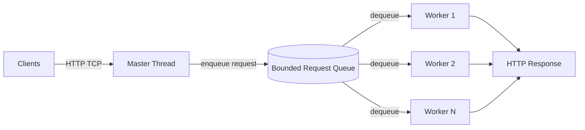
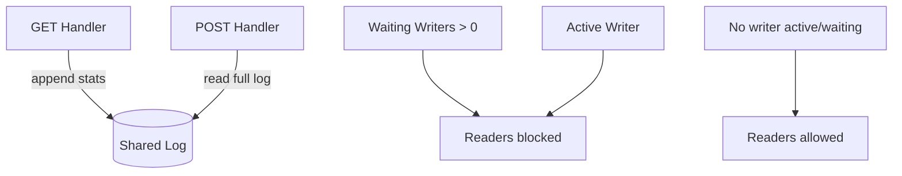
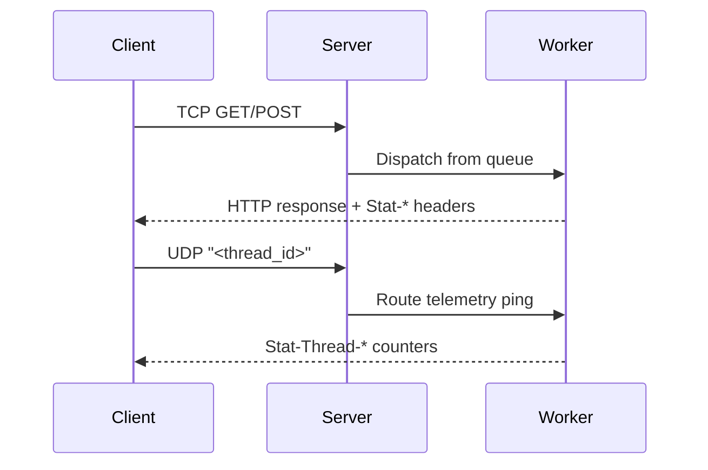

# NetPulse HTTP Server

NetPulse is a multithreaded HTTP server in C with a dual-channel observability model:
- **TCP** for HTTP traffic (GET/POST, static and CGI responses)
- **UDP** for lightweight per-thread telemetry polling

It is built as a producer-consumer system with a fixed thread pool and a writer-priority readers-writers log.

## Architecture

### Producer-Consumer Thread Pool



### Readers-Writers Log (Writer Priority)



### Dual-Channel Telemetry Protocol (TCP + UDP)



## Project Layout

- `src/` – C source files (`server`, request handling, log, network wrappers)
- `include/` – Public headers
- `tools/` – Operational tooling (`live_monitor.py`)
- `tests/` – Python build/test utilities
- `public/` – Runtime static assets (generated by `make`)

## Build

```bash
make
```

Artifacts:
- `./server`
- `./client`
- `./output.cgi`

## Run Server

```bash
./server <tcp_port> <udp_port> <threads> <queue_size> <debug_sleep_time>
```

Example:

```bash
./server 8080 9090 8 32 0
```

## Run Live Telemetry Dashboard + Load Generator

```bash
python3 tools/live_monitor.py \
  --tcp-port 8080 \
  --udp-port 9090 \
  --threads 8 \
  --clients 12
```

The dashboard concurrently:
1. Generates mixed GET/POST traffic over TCP.
2. Sends UDP pings every 200ms and prints live `Stat-Thread-*` utilization.
3. Computes dispatch latency from `Stat-Req-Arrival` and `Stat-Req-Dispatch` HTTP headers.

## Graceful Shutdown

Press `Ctrl+C` (`SIGINT`) to trigger graceful shutdown:
- master loop stops polling and closes sockets
- workers finish current request and exit
- queue/mailboxes/log synchronization primitives are released
- allocated resources are freed before process exit

## Test

```bash
python3 tests/public_suite.py -p .
```

